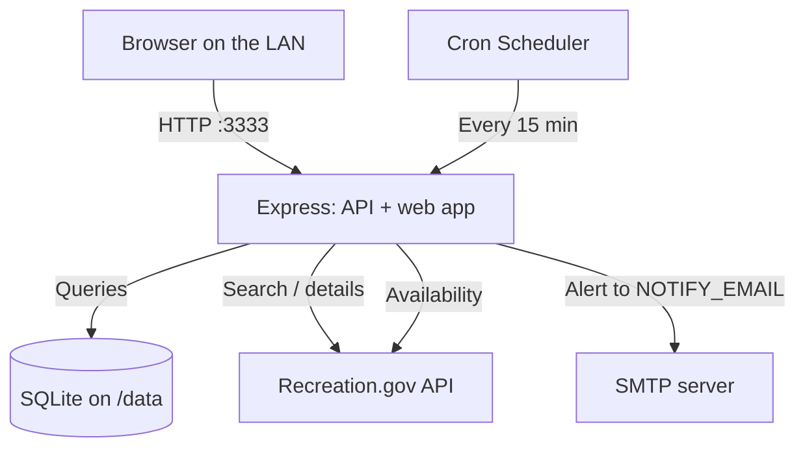
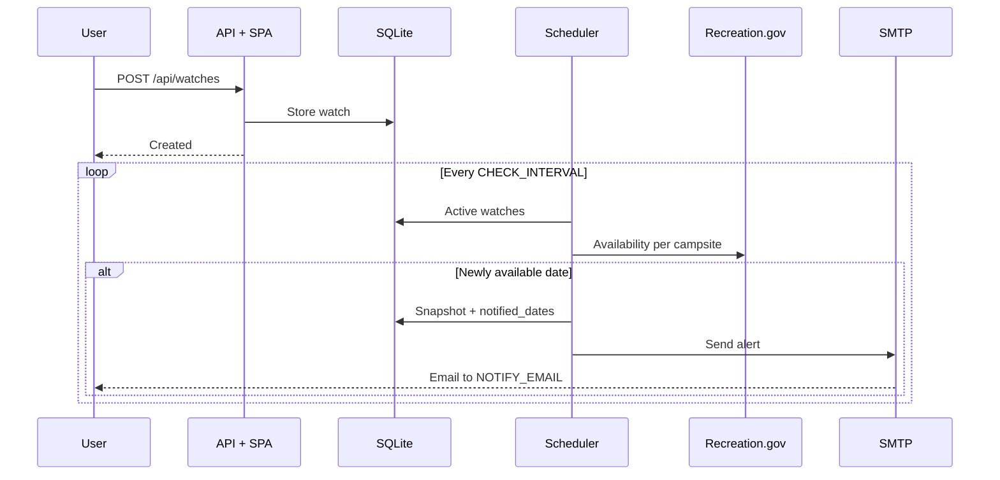

# CampSight

**Never miss a campsite booking again.** CampSight watches Recreation.gov for the sites and dates you care about and emails you the moment one opens up.

This is a fork of [areknow/campsight](https://github.com/areknow/campsight) trimmed for self-hosting on a home network: no Google sign-in, no access requests, one user, one container. Run it as a Portainer stack and keep it on the LAN.

[](https://react.dev/)
[](https://expressjs.com/)
[](https://www.typescriptlang.org/)
[](https://nx.dev/)

---

## Table of Contents

- [What changed from upstream](#what-changed-from-upstream)
- [Deploy with Portainer](#deploy-with-portainer)
- [Configuration](#configuration)
- [Features](#features)
- [How It Works](#how-it-works)
- [Local Development](#local-development)
- [Architecture](#architecture)
- [API Reference](#api-reference)
- [License](#license)

---

## What changed from upstream

- **No authentication.** Firebase and Google OAuth are gone. Every request runs as a single local user, and alerts go to `NOTIFY_EMAIL`. Anyone who can reach the port can use the app, so don't expose it beyond your network.
- **No landing, login, terms or access-request pages.** `/` goes straight to the dashboard.
- **One container.** Express serves the built web app alongside the API, replacing the Netlify + Railway split. The admin API moved from `/admin` to `/api/admin` so it doesn't collide with the admin page.
- **Admin panel is open.** Scheduler controls, activity feed and a test-email button are available to everyone on the network. The Users tab was removed since there is only one user.
- **Runtime config.** The Google Maps key is read from `GOOGLE_MAPS_API_KEY` when the page loads, so changing it is an env edit and a restart, not a rebuild.
- **Single-user database.** The `users` table holds one row with id `local`. Its email mirrors `NOTIFY_EMAIL` on each boot.

---

## Deploy with Portainer

Portainer clones this repo and builds the image on your Docker host, so there is nothing to publish first. The first deploy takes a few minutes while Nx compiles both apps.

1. In Portainer go to **Stacks → Add stack** and name it `campsight`.
2. Pick **Repository**, set the URL to `https://github.com/adamcnaglich/campsight`, reference `refs/heads/main`, compose path `docker-compose.yml`.
3. Under **Environment variables**, click **Load variables from .env file** and upload a copy of [`stack.env.example`](stack.env.example) with your values, or add `NOTIFY_EMAIL`, `SMTP_HOST`, `SMTP_USER`, `SMTP_PASS` and `RIDB_API_KEY` by hand.
4. **Deploy the stack**, then open `http://<host>:3333`.

The compose file uses `build: .`, so it has to be deployed from the repository rather than pasted into the web editor, unless a `campsight:latest` image already exists on the host.

### Updating

New commits on `main` are picked up by rebuilding: open the stack, click **Pull and redeploy**, and turn on **Re-pull image and redeploy**. To force a clean rebuild from a shell on the host, point compose at a checkout of this repo:

```bash
docker compose --env-file stack.env build --no-cache
docker compose --env-file stack.env up -d
```

### Data

SQLite lives on the `campsight-data` named volume at `/data/campsight.db`. To keep it in a host folder instead, replace the volume with a bind mount and `chown 1000:1000` that folder, since the container runs as the unprivileged `node` user.

### Image

The `Dockerfile` is a two-stage build: Nx compiles both apps, then a slim runtime image installs only the 13 packages the API bundle imports and serves the web build from `./public`. Build it anywhere with:

```bash
docker build -t campsight .
```

To have GitHub build and publish the image instead, move [`docs/github/docker-workflow.yml`](docs/github/docker-workflow.yml) to `.github/workflows/docker.yml` (pushing a workflow file needs a token with the `workflow` scope) and point the compose file at `ghcr.io/adamcnaglich/campsight:latest`.

---

## Configuration

Set these as stack environment variables in Portainer (or in `.env` for local development).

| Variable | Required | Default | Description |
| --- | --- | --- | --- |
| `NOTIFY_EMAIL` | Yes | | Address that receives availability alerts |
| `SMTP_HOST` | Yes | | SMTP server for alert emails, e.g. `smtp.mail.me.com` for iCloud |
| `SMTP_USER` | Yes | | SMTP login, e.g. your Apple ID address |
| `SMTP_PASS` | Yes | | SMTP password; iCloud needs an app-specific password |
| `RIDB_API_KEY` | Yes | | [RIDB](https://ridb.recreation.gov) key, used for campground details |
| `SMTP_PORT` | No | `587` | `587` uses STARTTLS, `465` implicit TLS |
| `SMTP_FROM` | No | `CampSight <SMTP_USER>` | Sender address; must be one your mail provider lets `SMTP_USER` send as |
| `SMTP_SECURE` | No | by port | `true` or `false` to override the TLS choice |
| `GOOGLE_MAPS_API_KEY` | No | | Google Maps JavaScript key for the campsite map. Without it the list view is used |
| `HOME_REGION` | No | `Michigan` | State shown in the "available near you" strip. On a LAN the client IP can't be geolocated, so this is used for every request |
| `CHECK_INTERVAL` | No | `*/15 * * * *` | Cron expression for availability checks |
| `CAMPSIGHT_PORT` | No | `3333` | Host port the stack publishes |
| `LOG_LEVEL` | No | `info` | `debug`, `info`, `warn`, `error` or `fatal` |
| `DATABASE_PATH` | No | `/data/campsight.db` | SQLite file location |
| `SCHEDULER_REQUEST_DELAY_MS` | No | `1000` | Pause between Recreation.gov requests in a cycle |
| `SCHEDULER_MAX_GROUPS_PER_CYCLE` | No | `0` | Cap on grouped campsite checks per cycle; `0` is unlimited |
| `SCHEDULER_RATE_LIMIT_COOLDOWN_MS` | No | `300000` | Back-off after a 429 from Recreation.gov |
| `SCHEDULER_NOTIFY_CLEAR_AFTER_MISSES` | No | `3` | Unavailable checks before a notified date may alert again |

---

## Features

- **5-step wizard** for campsite selection: search, campground, campsites, dates, review
- **Interactive map** of campsites when a Google Maps key is set, list view otherwise
- **Scheduled monitoring** polls Recreation.gov every 15 minutes (configurable)
- **Email alerts** over plain SMTP the first time a watched date turns available, with duplicate suppression
- **Multi-site watches** track several campsites in one watch
- **Dashboard** to pause, resume, edit or delete watches
- **Admin panel** with scheduler controls, run history and a test-email button

### Screenshots

| Dashboard | New watch: search |
| --- | --- |
|  |  |

| New watch: campgrounds | Watch detail |
| --- | --- |
|  |  |

---

## How It Works



1. You search for a recreation area or campground and pick campsites and dates.
2. The watch is stored in SQLite.
3. The scheduler checks availability for every active watch on the cron interval.
4. When a date flips to available, one email per watch goes to `NOTIFY_EMAIL`.
5. You book it on Recreation.gov.



---

## Local Development

Requires Node 22 or newer.

```bash
npm install
cp .env.example .env     # fill in NOTIFY_EMAIL, SMTP_*, RIDB_API_KEY

npx nx serve api         # http://localhost:3333
npx nx serve web         # http://localhost:4200, proxies /api to 3333
```

To run the production bundle the way the container does:

```bash
NODE_ENV=production npx nx run-many -t build -p api,web
WEB_DIR=dist/apps/web node dist/apps/api/main.js
```

Other commands:

```bash
npx nx run-many -t lint          # lint all projects
npx tsc --noEmit -p apps/web/tsconfig.app.json
npx tsc --noEmit -p apps/api/tsconfig.app.json
npx drizzle-kit studio           # browse the SQLite database
```

Tables are created and migrated by the API on startup, so there is no separate migration step.

---

## Architecture

```
campsight/
├── apps/
│   ├── web/            # React 19 + Vite SPA
│   └── api/            # Express API, scheduler, serves the SPA in production
├── libs/
│   └── shared/         # Zod schemas and types shared by both apps
├── docs/               # Screenshots and the local setup guide
├── Dockerfile          # Two-stage image: build with Nx, run with 13 packages
├── docker-compose.yml  # Portainer stack (Repository deploy, builds from .)
└── stack.env.example   # Stack environment variables
```

**Frontend:** React 19, Vite, TypeScript, SCSS modules, TanStack Query, React Router, Lucide icons, `@vis.gl/react-google-maps`.

**Backend:** Express, TypeScript, better-sqlite3 + Drizzle ORM, Pino logging, Helmet, node-cron, nodemailer.

**Why SQLite:** zero configuration, one file to back up, plenty for a household's worth of watches.

---

## API Reference

No authentication. Every request runs as the local user.

| Method | Path | Description |
| --- | --- | --- |
| `GET` | `/health` | Health check |
| `GET` | `/config.js` | Runtime config script loaded by the SPA |
| `GET` | `/api/me` | The local user (`id`, `email`, `displayName`) |
| `GET` | `/api/watches` | List watches |
| `POST` | `/api/watches` | Create a watch |
| `PATCH` | `/api/watches/:id` | Pause/resume or change dates |
| `DELETE` | `/api/watches/:id` | Delete a watch |
| `GET` | `/api/watches/:id/availability` | Latest availability per site |
| `GET` | `/api/campsites/suggest?q=` | Search suggestions for rec areas and campgrounds |
| `GET` | `/api/campsites/search?recAreaId=` | Campgrounds in a rec area |
| `GET` | `/api/campsites/search?facilityId=` | Campsites in a campground |
| `GET` | `/api/campsites/facility/:id` | Campground details (needs `RIDB_API_KEY`) |
| `GET` | `/api/available` | Campgrounds with openings near `HOME_REGION` |
| `GET` | `/api/admin` | Overview stats |
| `GET` | `/api/admin/watches` | All watches |
| `GET` | `/api/admin/activity` | Recent activity feed |
| `GET` | `/api/admin/scheduler/status` | Scheduler state |
| `POST` | `/api/admin/scheduler/{start,stop,restart,trigger}` | Scheduler controls |
| `POST` | `/api/admin/notifications/test` | Send a test email to `NOTIFY_EMAIL` over SMTP |

```bash
curl http://localhost:3333/api/watches
```

---

## License

Private. All rights reserved.

---

**Built with ❤️ for camping enthusiasts and outdoor adventurers.**
