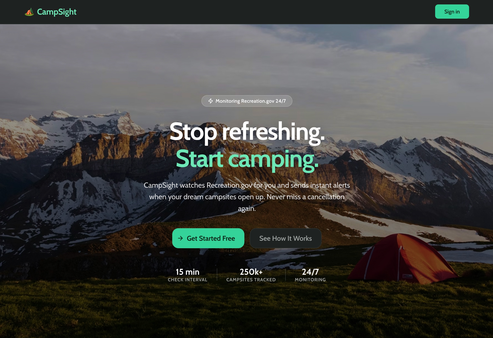
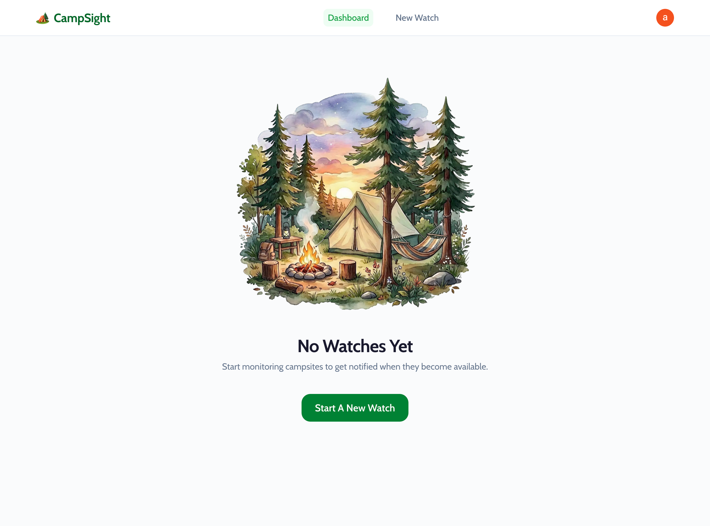
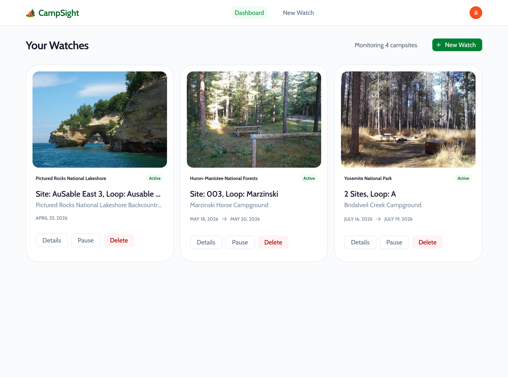
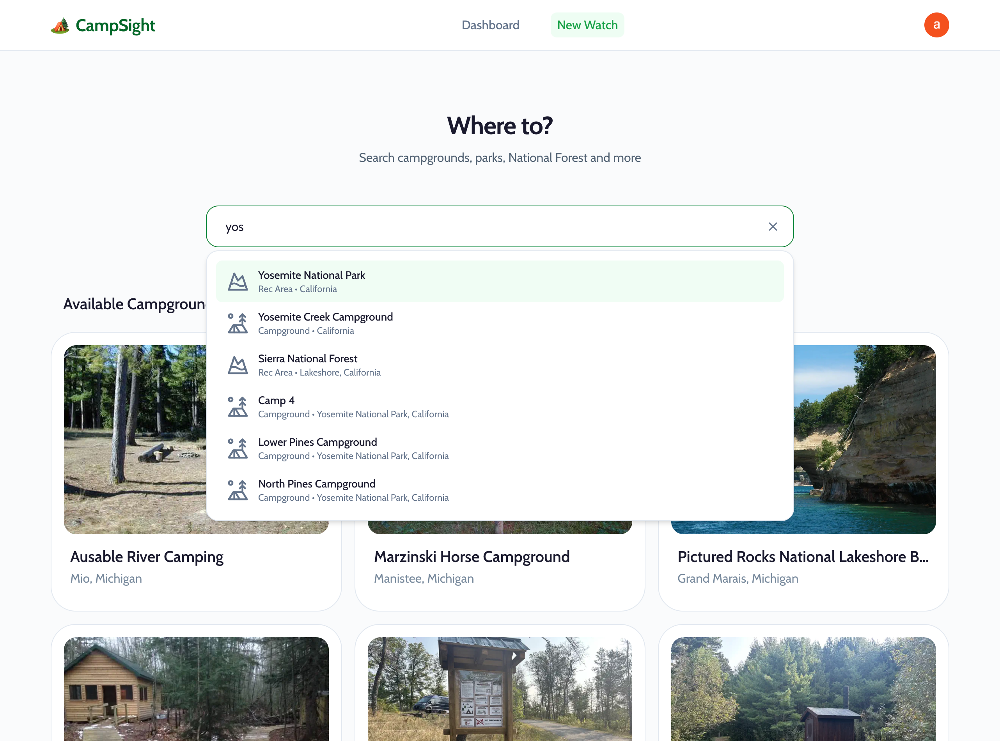
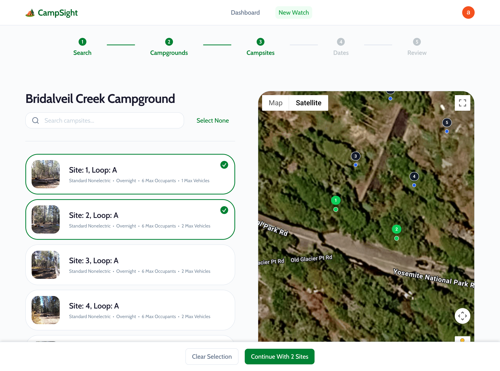
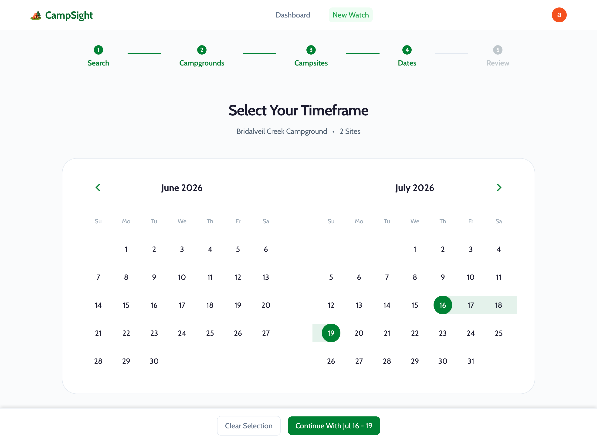
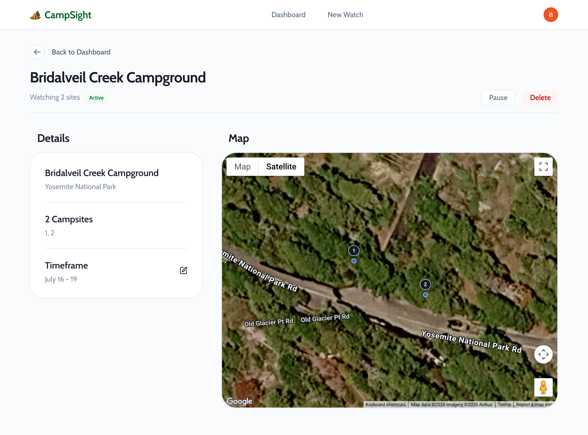
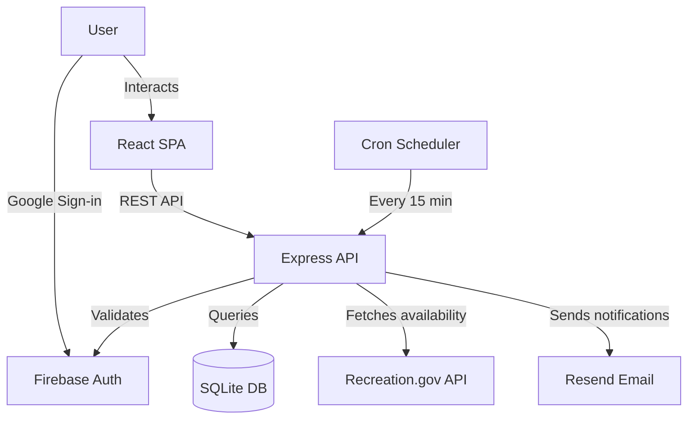
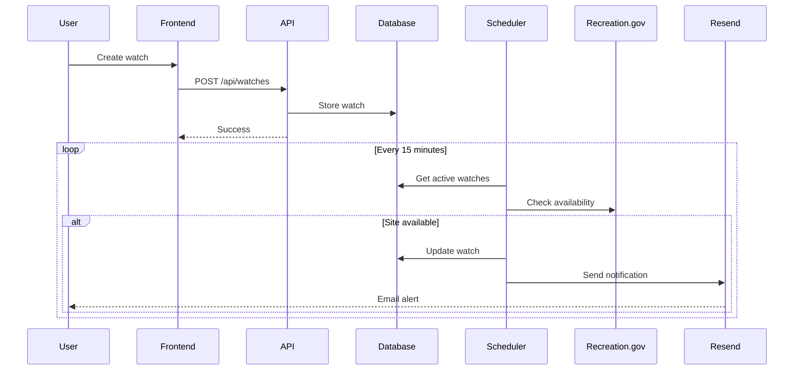

# CampSight

**Never miss a campsite booking again.** Monitor Recreation.gov campsites in real-time and get notified the moment your dream spot becomes available.

<!-- TODO: Add landing page hero screenshot here -->
<!--  -->

[](https://react.dev/)
[](https://expressjs.com/)
[](https://www.typescriptlang.org/)
[](https://nx.dev/)
[](https://app.netlify.com/projects/camp-sight/deploys)

---

## Table of Contents

- [Features](#features)
- [Screenshots](#screenshots)
- [Tech Stack](#tech-stack)
- [How It Works](#how-it-works)
- [Getting Started](#getting-started)
- [Architecture](#architecture)
- [API Reference](#api-reference)
- [Deployment](#deployment)
- [License](#license)

---

## Features

### Smart Campsite Monitoring

- **5-step wizard** for intuitive campsite selection
- **Interactive map** to visualize and select specific campsites
- **Real-time monitoring** checks availability every 15 minutes (configurable)
- **Instant notifications** via email when sites become available
- **Multi-site tracking** watch multiple campsites in a single search
- **Date range flexibility** specify your exact camping dates

### User Experience

- **Google OAuth** for secure, passwordless authentication
- **Request/approval flow** for controlled access
- **Responsive design** works seamlessly on desktop and mobile
- **Dashboard** view all your active watches at a glance
- **Watch management** easily pause, edit, or delete watches

### Developer Features

- **Full TypeScript** end-to-end type safety
- **Monorepo architecture** shared types and schemas between frontend/backend
- **Structured logging** production-ready with Pino
- **Database ORM** type-safe queries with Drizzle
- **Modern tooling** Vite for fast builds, TanStack Query for state management

---

## Screenshots

### Landing Page

The home page explains the value proposition and guides users to get started.



### Dashboard

Monitor all your active watches in one place. See which campsites you're tracking and their current availability status.

**Empty State:**

<!-- TODO: Add dashboard empty state screenshot -->



**With Active Watches:**

<!-- TODO: Add dashboard with watches screenshot -->



### New Watch Flow

A guided 5-step process makes it easy to set up campsite monitoring:

**Step 1 — Search for Recreation Areas or Campgrounds**

<!-- TODO: Add search step screenshot -->



**Step 2/3 — Browse Campgrounds and campsites on interactive map**

<!-- TODO: Add campgrounds selection screenshot -->



**Step 4 — Choose Your Dates**

<!-- TODO: Add dates selection screenshot -->



### Watch Detail

View detailed availability information and edit watch settings.

<!-- TODO: Add watch detail screenshot -->



---

## Tech Stack

### Architecture Overview



### Frontend

- **React 19** — Latest features including automatic batching
- **Vite** — Lightning-fast dev server and builds
- **TypeScript** — Full type safety
- **SCSS Modules** — Scoped styling with CSS preprocessing
- **TanStack Query** — Server state management with caching
- **React Router 7** — Client-side routing
- **Lucide React** — Beautiful icon library
- **React Google Maps** — Interactive map integration

### Backend

- **Express** — Fast, minimalist web framework
- **TypeScript** — End-to-end type safety
- **SQLite** — Lightweight embedded database
- **better-sqlite3** — Synchronous SQLite bindings
- **Drizzle ORM** — Type-safe SQL query builder
- **Pino** — High-performance structured logging
- **Helmet** — Security middleware
- **node-cron** — Scheduled tasks for availability checks

### Infrastructure & Services

- **Firebase Authentication** — Google OAuth integration
- **Resend** — Transactional email delivery
- **Recreation.gov RIDB API** — Campsite data and availability
- **Netlify** — Frontend hosting with CDN
- **Railway** — Backend hosting with persistent volumes
- **Nx** — Monorepo build system

---

## How It Works

1. **User searches** for a recreation area or specific campground
2. **System fetches** available campgrounds from Recreation.gov API
3. **User selects** campground, campsites, and date range through the wizard
4. **Watch is created** and stored in the database
5. **Cron scheduler** checks availability every 15 minutes (configurable)
6. **When a site becomes available**, user receives an email notification
7. **User books** the campsite on Recreation.gov

### Data Flow



---

## Getting Started

### Quick Start

```bash
# Clone the repository
git clone <your-repo-url>
cd campsight

# Install dependencies
npm install

# Set up environment variables
cp .env.example .env
# Edit .env with your API keys (see SETUP.md for details)

# Start the backend (http://localhost:3333)
npx nx serve api

# In another terminal, start the frontend (http://localhost:4200)
npx nx serve web
```

Visit http://localhost:4200 and sign in with Google to start monitoring campsites!

### Prerequisites

- Node.js 18+
- Firebase project with Google Auth enabled
- Resend account (free tier available)
- Recreation.gov RIDB API key (free)

**Need detailed setup instructions?** See the [Setup Guide](docs/SETUP.md) for complete configuration steps.

---

## Architecture

### Monorepo Structure

```
campsight/
├── apps/
│   ├── web/          # React frontend (Vite)
│   └── api/          # Express backend
├── libs/
│   └── shared/       # Shared types and Zod schemas
├── docs/             # Documentation
│   ├── screenshots/  # README screenshots
│   ├── SETUP.md      # Detailed setup guide
│   └── DEPLOYMENT.md # Deployment instructions
└── data/             # SQLite database (local)
```

### Key Design Decisions

**Why SQLite?**

- Zero configuration for development
- Sufficient for thousands of watches
- Easy backup (single file)
- Can migrate to PostgreSQL later if needed

**Why Firebase Auth?**

- Handles OAuth flow complexity
- No password management needed
- Built-in security features
- Free tier is generous

**Why Monorepo?**

- Share types between frontend and backend
- Single source of truth for validation schemas
- Efficient caching and task orchestration with Nx

**Why Email Notifications?**

- Universal delivery (no app install required)
- Works on all devices
- Reliable delivery with Resend

---

## API Reference

All routes except `/health` require a Firebase Auth bearer token in the `Authorization` header.

### Endpoints

| Method   | Path                            | Description                             | Auth Required |
| -------- | ------------------------------- | --------------------------------------- | ------------- |
| `GET`    | `/health`                       | Health check endpoint                   | No            |
| `GET`    | `/api/watches`                  | List user's active watches              | Yes           |
| `POST`   | `/api/watches`                  | Create a new watch                      | Yes           |
| `PATCH`  | `/api/watches/:id`              | Update watch (pause/resume, edit dates) | Yes           |
| `DELETE` | `/api/watches/:id`              | Delete a watch                          | Yes           |
| `GET`    | `/api/watches/:id/availability` | Get current availability for watch      | Yes           |
| `GET`    | `/api/campsites/search`         | Search campgrounds/campsites            | Yes           |
| `GET`    | `/api/campsites/facility/:id`   | Get facility details                    | Yes           |

### Example Request

```bash
# Get all watches
curl -H "Authorization: Bearer YOUR_FIREBASE_TOKEN" \
  http://localhost:3333/api/watches
```

### Example Response

```json
[
  {
    "id": 1,
    "userId": "firebase_user_id",
    "campgroundName": "Upper Pines Campground",
    "recAreaName": "Yosemite National Park",
    "startDate": "2026-07-01",
    "endDate": "2026-07-05",
    "isActive": true,
    "sites": [
      {
        "campsiteId": "12345",
        "campsiteName": "Site 001",
        "loop": "Upper Loop"
      }
    ],
    "createdAt": "2026-04-20T10:30:00Z",
    "updatedAt": "2026-04-20T10:30:00Z"
  }
]
```

---

## Deployment

CampSight uses a split deployment strategy:

- **Frontend (React SPA)** — Deployed to [Netlify](https://netlify.com)
- **Backend (Express API)** — Deployed to [Railway](https://railway.app)

### Deployment Architecture

```
┌─────────────────────┐         ┌─────────────────────┐
│   Netlify (CDN)     │         │   Railway (API)     │
│                     │         │                     │
│   React SPA         │────────▶│   Express Server    │
│   Static Assets     │  HTTPS  │   SQLite Database   │
│                     │         │   Cron Scheduler    │
└─────────────────────┘         └─────────────────────┘
                                          │
                                          ├────▶ Firebase Auth
                                          ├────▶ Recreation.gov API
                                          └────▶ Resend Email
```

### Quick Deploy

**Frontend (Netlify):**

1. Connect your GitHub repository
2. Build command: `npx nx build web`
3. Publish directory: `dist/apps/web`
4. Add environment variables for Firebase and API URL

**Backend (Railway):**

1. Connect your GitHub repository
2. Railway auto-detects Node.js and uses `railway.toml`
3. Mount a persistent volume at `/data` for SQLite
4. Add environment variables for Firebase, Resend, and RIDB API

**For detailed deployment instructions**, see the [Deployment Guide](docs/DEPLOYMENT.md).

---

## Development

### Build Commands

```bash
# Build both apps
npx nx run-many -t build

# Build specific app
npx nx build web
npx nx build api
```

### Testing

```bash
# Run tests
npx nx test web
npx nx test api

# Run with coverage
npx nx test web --coverage
```

### Linting

```bash
# Lint all projects
npx nx run-many -t lint

# Auto-fix issues
npx nx run-many -t lint -- --fix
```

### Database Management

```bash
# Generate migrations (after schema changes)
npx drizzle-kit generate

# Push schema to database
npx drizzle-kit push

# Open Drizzle Studio (visual database editor)
npx drizzle-kit studio
```

---

## Project Highlights

### Technical Challenges Solved

**1. Efficient Availability Polling**

- Implemented smart cron scheduling to balance API rate limits with timely notifications
- Optimized database queries to handle hundreds of concurrent watches
- Added configurable intervals for different environments

**2. Type-Safe Monorepo**

- Shared Zod schemas ensure consistent validation between frontend and backend
- TypeScript types automatically generated from schemas
- Nx caching dramatically speeds up builds

**3. Authentication & Authorization**

- Firebase Admin SDK validates tokens on the backend
- Middleware automatically attaches user context to requests
- Access control system for managing user onboarding

**4. Production Logging**

- Structured JSON logs in production for easy parsing
- Pretty-printed logs in development for better DX
- Automatic request logging with response times and user context

**5. Interactive Map Integration**

- React Google Maps integration for visual campsite selection
- Custom markers and info windows for better UX
- Fallback to list view when map is unavailable

### What I'd Do Differently

- **Add caching layer** for Recreation.gov API responses to reduce external calls
- **Implement webhooks** instead of polling for real-time updates (if API supported)
- **Add unit tests** for critical business logic (scheduler, availability checker)
- **Migrate to PostgreSQL** for better concurrency and built-in replication
- **Add rate limiting** on API endpoints to prevent abuse
- **Implement SMS notifications** as an alternative to email

---

## Contributing

This is a personal project, but suggestions and feedback are welcome! Feel free to open an issue to discuss improvements or report bugs.

---

## License

Private. All rights reserved.

---

## Screenshots Guide

To capture the screenshots for this README:

1. **Run the app locally** with realistic data (create several sample watches)
2. **Use consistent browser width** (1440px or 1920px recommended)
3. **Capture clean screenshots** without browser UI if possible
4. **Save to `docs/screenshots/`** with these filenames:
   - `landing.png` — Landing page hero
   - `dashboard-empty.png` — Empty state
   - `dashboard-with-watches.png` — Dashboard with 3-4 watches
   - `new-watch-search.png` — Search step
   - `new-watch-campgrounds.png` — Campgrounds selection
   - `new-watch-campsites-map.png` — Map view with campsites
   - `new-watch-dates.png` — Date picker
   - `new-watch-review.png` — Review step
   - `watch-detail.png` — Watch detail page
   - `settings.png` — Settings page
5. **Uncomment the image tags** in this README

**Screenshot tips:**

- Use a campground everyone knows (Yosemite, Yellowstone, Grand Canyon)
- Show the app with data loaded (not loading states)
- Capture some interactions (e.g., hover states, selected items)
- Consider adding light annotations (arrows, highlights) for key features

---

**Built with ❤️ for camping enthusiasts and outdoor adventurers.**
